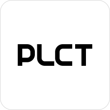

# Meow Language

**English** | [繁體中文](README.zh-TW.md) | [简体中文](README.zh-CN.md) | [日本語](README.ja.md) | [한국어](README.ko.md)

[](https://github.com/alssssssssooo/MeowLang/actions/workflows/ci.yml) [](https://github.com/alssssssssooo/MeowLang/releases/latest)

<small>這是一門為了讓貓科動物——例如老虎、貓、貓娘——也能當程式設計師而研發的程式語言。<br>
This language was created so that felines — tigers, cats, and catgirls — can also become programmers.</small>

> **🐱 For entertainment only — 純屬娛樂，不可當作正規使用**
>
> MeowLang is an esoteric toy language built for fun. **It is not a
> production language and must never be used for serious, academic, or
> real-world work.** No stability guarantees, no support promises.
> If a cat sits on your keyboard and the program still runs, that is
> a successful code review.

> **Fork notice**
>
> This repository is a fork of [Glavo/MeowLang](https://github.com/Glavo/MeowLang).
> **This fork — including the native C implementation, the lightweight DOCX
> reader, the performance rewrite, the Meow cipher, and the multilingual
> documentation — was developed by DeepSeek V4.1 Flash.**
> The original language design and the original Java implementation belong to
> Glavo.

MeowLang is an esoteric programming language in which **the source code is a
Microsoft Word document**. A program is a wall of styled `喵` (meow) symbols,
and the formatting *is* the syntax: color, bold, underline, highlight, and
italic decide what a `喵` means. The compiled `.docx` looks like encrypted
cats in Word, and the native interpreter runs it directly.


## Features

### Rich-text programming

Meow uses Microsoft Word as its editor. It supports rich-text programming, so
developers can embed formatted text, images, and other content directly in the
source code and print them to the terminal.


### One keyword, zero names

Raw Meow keeps only one symbol: the sound of a cat. There are no
user-defined identifiers, brackets, or quotes. Formatting is the identity —
two `喵` runs are the same symbol only if every formatting attribute matches.

Instead of naming variables, developers give each `喵` a different color,
highlight, bold, underline, and so on. Every distinct combination is a distinct
identifier.


### Write "meow" in any language

The interpreter does not force the English word "Meow". It accepts the sound
of a cat in dozens of languages:

`meow` · `miaou` · `miao` · `nyan` · `にゃん` · `야옹` · `喵` · `喵呜` ·
`мяу` · `мјау` · `miyav` · `miau` · `miauw` · `μιάου` · `mjau` · `mjäu` ·
`mjav` · `mjal` · `nyávog` · `म्याऊं` · `meong` · `mjá` · `meo meo` ·
`მიაუ` · `myau` · `ngiyavuma` · `ማው` · `maw`

**The word itself is never the identity — the formatting is.** All the words
above are interchangeable synonyms: two runs mean the same symbol whenever
their formatting matches, no matter which language each word comes from. You
can therefore write raw Meow in whichever language you think in, or mix
several languages inside one program — it makes hand-writing *easier*, not
harder, because there is no "correct" spelling of a meow. Case is not
significant either (`Μιάου` and `Мяу` are recognized). And if you use the
Python-style frontend below, you never have to type a single meow.


### The Meow cipher — no fonts required

Built-in functions and macros are written as two-syllable meow code words
plus formatting. The code word is only a visual category; the unique
identity of each built-in is the combination of
**8 reserved colors × bold × double underline × yellow highlight**
(64 combinations, 53 in use):

| Code word | Category |
| --- | --- |
| `喵喵` | I/O |
| `喵嗚` | arithmetic and comparison |
| `嗚喵` | lists and strings |
| `嗚嗚` | control flow and syntax |

Because the cipher uses only standard text and formatting, the compiled DOCX
displays correctly in **any** Word installation out of the box — there is
nothing to install. The full code-to-name mapping is in the
[cipher legend](#meow-cipher-legend); the shared machine-readable
specification lives in `tools/meow_cipher.py`.

## Quick start

```bash
# Termux / Android:
pkg install clang make zlib expat libpng libjpeg-turbo
# Other systems: a C11 compiler, make, and zlib/expat/libpng/libjpeg
make -C native

# Compile a program and run it
python3 tools/meowc.py examples/game2048.meow -o game2048.docx
./native/meow game2048.docx
```

2048 controls:

```text
w = up    a = left    s = down    d = right    q = quit
```

## Writing programs: the `.meow` frontend

Writing raw Meow by hand means adjusting the color, bold, underline, and
italic of every symbol in Word. The optional Python-style frontend
(`tools/meowc.py`) does all of that for you: you write ordinary
Python-flavored `.meow` source, and it compiles into the same styled `.docx`.
The runtime is still the native C binary; Java and Python are not involved at
execution time.

### Variables and assignment

```python
x = 10
x += 1
items = [1, 2, 3]
items[0] = 9
```

### Arithmetic and comparisons

```python
print(1 + 2, 7 // 2, 7 % 3, 2 ** 10)
print(x > 5 and x < 100)
print(3 in items)
```

Supported operators: `+` `-` `*` `/` `//` `%` `**`, comparisons
`==` `!=` `<` `<=` `>` `>=`, and `and` `or` `not`.

`/` and `//` both perform integer division rounded toward negative infinity.
There are no floating-point numbers in this language.

### Conditionals

```python
if x > 10:
    print("big")
elif x == 10:
    print("ten")
else:
    print("small")
```

### Loops

```python
i = 0
while i < 5:
    print(i)
    i += 1

for n in range(1, 6):
    print(n)

for ch in "meow":
    print(ch)
```

`for` iterates over lists and over the Unicode code points of text.

### Functions and early return

```python
def fact(n):
    if n <= 1:
        return 1
    return n * fact(n - 1)

print(fact(6))
```

Functions support recursion and early `return`.

### Lists and strings

```python
a = [1, 2, 3]
a.append(4)
print(a[0], a[-1], a[1:3], len(a))
print(str(123) + "!", int("42") + 1)
```

### Conditional expression

```python
print("yes" if 3 > 2 else "no")
```

### Name mapping

To keep the runtime small, the frontend maps some Python names to native
built-in functions:

| Python syntax | Runtime symbol | Notes |
| --- | --- | --- |
| `print(...)` | `println` | Space-separated arguments, then a newline |
| `input(prompt)` | `readline` | Reads one line from standard input |
| `int(text)` | `parseInt` | Decimal integer string to integer |
| `a.append(x)` | `push` | Appends to a list in place |
| `a.pop()` | `pop` | Removes and returns the last element |
| `x in a` | `contains(a, x)` | List membership or substring test |

### Not supported yet

- `break`, `continue`, and loop `else`
- Classes, exceptions, and `with`
- Keyword arguments, default arguments, and variadic arguments
- `not in`, `is`, and chained comparisons such as `a < b < c`
- Floating-point numbers and f-strings
- In-place list methods such as `extend`, `insert`, and `remove`
- String methods such as `.upper()` and `.lower()`

Use raw Meow syntax, or extend `native/meow.c` and `tools/meowc.py`, when
these features are needed.

### Frontend command line

```text
python3 tools/meowc.py SOURCE [-o OUTPUT.docx] [--dump-ast] [--dump-runtime]
```

- Without `-o`, the output uses the source name with a `.docx` extension.
- `--dump-ast` prints the frontend AST; `--dump-runtime` prints the
  generated runtime expressions. Both are for debugging.

## Running programs

```bash
./native/meow ./demo/HelloWorld.docx
```

You can pass multiple `.docx` files; each file gets a fresh context.

```bash
./native/meow ./demo/HelloWorld.docx ./play/card.docx
```

### Environment variables

| Variable | Implementation | Effect |
| --- | --- | --- |
| `MEOW_DEBUG=1` | native | Print the parsed expression and evaluation trace |
| `MEOW_PLAIN=1` | Java | Always use the lightweight plain console (no JLine) |
| `MEOW_JLINE=1` | Java | Always use JLine, even when stdin is not a terminal |

## Reading and writing raw Meow

Raw Meow is written directly in Word. You do not need any fonts — only the
standard formatting pane.

### The formatting model

- A paragraph is one expression list. Runs that are not meow words (spaces,
  ordinary text outside literals) are skipped.
- **Italic `喵` pair = a group** (parentheses). The opening and closing runs
  must share the same formatting; the compiler shades groups by nesting
  depth, but any consistent italic color works.
- **Single-underlined `喵` pair = a text literal.** The compiled form uses
  the color `0x7030A0`; the content between the delimiters is preserved as
  rich text.
- **A plain `喵` with a unique color = a variable.** The color must not
  collide with the reserved palette below.
- **A cipher code word with its reserved formatting = a built-in.**

The reserved palette (never use these for your own variables):
`0x000000` (literal content), `0x7030A0` (literal delimiters), and the eight
cipher colors `0xC00000`, `0xC07000`, `0x909000`, `0x008000`, `0x008080`,
`0x0070C0`, `0x8060C0`, `0xC000C0`. Variables may use any other color.

Accepted meow words (all interchangeable, case-insensitive): the 28 words
listed under *Write "meow" in any language*, plus the four cipher code words
`喵喵`, `喵嗚`, `嗚喵`, `嗚嗚`.

### Built-in macros

| Macro | Shape | Meaning |
| --- | --- | --- |
| `let` | `(x value)` | Bind `value` to the variable `x` |
| `lambda` | `(params body...)` | Function value; `params` is one identifier or a group of identifiers |
| `if` | `(cond then [else])` | Conditional |
| `while` | `(cond body...)` | Loop while `cond` is truthy |
| `for` | `(var iterable body...)` | Iterate a list or text |
| `do` | `(body...)` | Evaluate in sequence |
| `return` | early return from the enclosing function | |
| `and` / `or` | short-circuit booleans | |
| `integer` | size-encoded `喵` | Legacy integer literal (the value is stored in the font size); prefer `parseInt("...")` |

### Built-in functions

- **I/O**: `print`, `println`, `readline`, `clear`
- **Arithmetic**: `add`, `sub`, `mul`, `div`, `mod`, `pow`, `neg`, `abs`,
  `min`, `max`, `sum`
- **Comparison**: `eq`, `ne`, `lt`, `le`, `gt`, `ge`, `not`
- **Lists**: `list`, `cons`, `head`, `tail`, `len`, `get`, `set`, `push`,
  `pop`, `concat`, `slice`, `range`, `contains`, `join`
- **Strings**: `str`, `parseInt`, `textLen`, `charAt`, `substring`
- **Misc**: `random`, `srand`

### Meow cipher legend

Every built-in is the combination of its code word, color, bold, double
underline, and yellow highlight. The native tables in `native/meow.c` are
generated from the same specification as the compiler
(`tools/meow_cipher.py`), so the two can never drift apart.

<details open>
<summary><code>喵喵</code> — I/O（輸出入）</summary>

| Built-in | Color | Bold | Underline | Highlight |
| --- | --- | --- | --- | --- |
| `print` | dark red `0xC00000` | — | — | — |
| `readline` | orange `0xC07000` | — | — | — |
| `println` | dark gold `0x909000` | — | — | — |
| `clear` | green `0x008000` | — | — | — |

</details>

<details>
<summary><code>喵嗚</code> — arithmetic & comparison（數學／比較）</summary>

| Built-in | Color | Bold | Underline | Highlight |
| --- | --- | --- | --- | --- |
| `add` | teal `0x008080` | — | — | — |
| `sub` | blue `0x0070C0` | — | — | — |
| `mul` | violet `0x8060C0` | — | — | — |
| `div` | magenta `0xC000C0` | — | — | — |
| `mod` | dark red `0xC00000` | **yes** | — | — |
| `pow` | orange `0xC07000` | **yes** | — | — |
| `neg` | dark gold `0x909000` | **yes** | — | — |
| `abs` | green `0x008000` | **yes** | — | — |
| `min` | teal `0x008080` | **yes** | — | — |
| `max` | blue `0x0070C0` | **yes** | — | — |
| `sum` | violet `0x8060C0` | **yes** | — | — |
| `eq` | magenta `0xC000C0` | **yes** | — | — |
| `ne` | dark red `0xC00000` | — | double | — |
| `lt` | orange `0xC07000` | — | double | — |
| `le` | dark gold `0x909000` | — | double | — |
| `gt` | green `0x008000` | — | double | — |
| `ge` | teal `0x008080` | — | double | — |
| `not` | blue `0x0070C0` | — | double | — |
| `parseInt` | violet `0x8060C0` | — | double | — |
| `random` | magenta `0xC000C0` | — | double | — |
| `srand` | dark red `0xC00000` | **yes** | double | — |

</details>

<details>
<summary><code>嗚喵</code> — lists & strings（列表／字串）</summary>

| Built-in | Color | Bold | Underline | Highlight |
| --- | --- | --- | --- | --- |
| `contains` | orange `0xC07000` | **yes** | double | — |
| `list` | dark gold `0x909000` | **yes** | double | — |
| `cons` | green `0x008000` | **yes** | double | — |
| `head` | teal `0x008080` | **yes** | double | — |
| `tail` | blue `0x0070C0` | **yes** | double | — |
| `len` | violet `0x8060C0` | **yes** | double | — |
| `get` | magenta `0xC000C0` | **yes** | double | — |
| `set` | dark red `0xC00000` | — | — | yellow |
| `push` | orange `0xC07000` | — | — | yellow |
| `pop` | dark gold `0x909000` | — | — | yellow |
| `concat` | green `0x008000` | — | — | yellow |
| `slice` | teal `0x008080` | — | — | yellow |
| `range` | blue `0x0070C0` | — | — | yellow |
| `str` | violet `0x8060C0` | — | — | yellow |
| `textLen` | magenta `0xC000C0` | — | — | yellow |
| `charAt` | dark red `0xC00000` | **yes** | — | yellow |
| `substring` | orange `0xC07000` | **yes** | — | yellow |
| `join` | dark gold `0x909000` | **yes** | — | yellow |

</details>

<details>
<summary><code>嗚嗚</code> — control flow & syntax（控制／語法）</summary>

| Built-in | Color | Bold | Underline | Highlight |
| --- | --- | --- | --- | --- |
| `let` | green `0x008000` | **yes** | — | yellow |
| `lambda` | teal `0x008080` | **yes** | — | yellow |
| `integer` | blue `0x0070C0` | **yes** | — | yellow |
| `if` | violet `0x8060C0` | **yes** | — | yellow |
| `while` | magenta `0xC000C0` | **yes** | — | yellow |
| `for` | dark red `0xC00000` | — | double | yellow |
| `do` | orange `0xC07000` | — | double | yellow |
| `return` | dark gold `0x909000` | — | double | yellow |
| `and` | green `0x008000` | — | double | yellow |
| `or` | teal `0x008080` | — | double | yellow |

</details>

## Examples

- `examples/hello.meow` — input and output.
- `examples/test1.meow` — arithmetic, control flow, functions, lists, and
  strings.
- `examples/game2048.meow` — a complete, playable text-mode 2048 game.

```bash
python3 tools/meowc.py examples/test1.meow
./native/meow examples/test1.docx
```

## Two implementations

This fork ships two implementations of the same language:

| Implementation | Artifact | Runtime | Status |
| --- | --- | --- | --- |
| **Native (recommended)** | `native/meow` | None (native ELF binary) | Actively developed |
| Java (legacy) | `meow.jar` | JVM 21+ | Kept for reference |

Both read the same `.docx` files. The native binary produces the same text
output as the Java version; only some ANSI reset sequences differ.

## What is new in this fork

| Area | Upstream | This fork (Java) | This fork (native) |
| --- | --- | --- | --- |
| DOCX parsing | Apache POI + XMLBeans | `ZipFile` + StAX | Own ZIP reader + expat |
| Runtime | JVM | JVM | No JVM |
| Artifact size | ~22.6 MB JAR | ~1.5 MB JAR | ~56 KB binary |
| `demo/HelloWorld.docx` | ~1.7 s | ~0.42 s | ~0.024 s |
| `play/card.docx` | ~1.5 s | ~0.37 s | ~0.03 s |

The native version implements the ZIP central-directory reader itself, inflates
entries with zlib, parses `word/document.xml` and its relationships with expat,
and decodes embedded PNG/JPEG images with libpng and libjpeg. Images are printed
as ANSI half-block art, just like the Java version.

### Performance

Measured on Termux / Android aarch64 (native: 50 runs; Python 3.13.13
reference: 30 runs):

| Workload | Time per run |
| --- | --- |
| Native `meow --version` (startup only) | 0.020 s |
| Native full `demo/HelloWorld.docx` (ZIP + XML + interpreter + PNG + ANSI) | 0.024 s |
| Python 3.13 bare startup (`python3 -c pass`) | 0.050 s |
| Python 3.13 unzip `word/document.xml` only | 0.084 s |

The native binary finishes the whole demo faster than bare Python starts, and
more than three times faster than Python merely extracts the document XML. The
Python rows do not parse, interpret, or render anything; they are a lower bound,
not an equivalent implementation.

## Build the native binary

Requirements:

- A C11 compiler (`clang` or `gcc`)
- `make`
- zlib, expat, libpng, libjpeg development files

On Termux:

```bash
pkg install clang make zlib expat libpng libjpeg-turbo
```

Then:

```bash
make -C native
```

Or with CMake:

```bash
cmake -S native -B build-native
cmake --build build-native
```

The binary is written to `native/meow`.

## Symbol fonts (optional, legacy)

Earlier versions of this fork encoded every built-in into a custom
`Meow-<name>.ttf` font name, which meant installing 48 generated fonts to
read a compiled DOCX in Word. **The Meow cipher replaced that: newly compiled
DOCX files need no fonts at all.**

The `fonts/` directory is kept for compatibility with older, font-encoded
DOCX files (and for anyone who prefers that look on those files). Installing
fonts never affects execution: the DOCX text is still meow symbols either way,
and the interpreter ignores fonts.

Install for the current user (Linux, macOS, Termux):

```bash
./fonts/install-fonts.sh --user
```

Android system-wide installation requires root and a reboot:

```bash
su -c 'sh fonts/install-fonts.sh --android-module --yes'
```

The release installer skips fonts by default; pass `--fonts` to install them.
See `fonts/README.md` for details, including backup and uninstall behaviour.

## Build and run the Java version (optional)

```bash
./gradlew meow
java -jar meow.jar ./demo/HelloWorld.docx
```

Or use the self-executing script:

```bash
./meow.sh ./demo/HelloWorld.docx
```

## Project layout

```text
native/
├── meow.c                 native interpreter (ZIP + XML + ANSI + images)
├── Makefile               pkg-config / fallback build
└── CMakeLists.txt         portable CMake build
fonts/                     legacy, optional symbol fonts
├── Meow-*.ttf             U+55B5 -> readable built-in name (old encoding)
├── install-fonts.sh       user / Android module installer
├── README.md              installation and regeneration notes
└── NOTICE                 Droid Sans Mono attribution
tools/
├── meowc.py               Python-style .meow -> .docx compiler
├── meow_cipher.py         Meow-cipher specification (single source of truth)
├── gen_meow_fonts.py      regenerate the legacy Meow-* symbol fonts
└── package-release.sh     build a release tarball
examples/
├── hello.meow
├── test1.meow
└── game2048.meow
src/main/java/org/glavo/meow/
├── Main.java              Java entry point
├── Meow.java              symbol (a "Meow" with formatting attributes)
├── MeowDocxReader.java    lightweight DOCX reader (ZipFile + StAX)
├── MeowRun.java           lightweight replacement for XWPFRun
├── MeowParser.java        parser
├── MeowConsole.java       console abstraction (plain / JLine)
├── JlineConsole.java      lazily loaded JLine adapter
└── value/                 runtime values and built-in functions
```

## License

All source code in this repository is released under
[GPLv3](https://www.gnu.org/licenses/gpl-3.0.html).

All other files (`.docx`, `.md`, `.png`, and so on) are released under
[CC BY-SA 4.0](https://creativecommons.org/licenses/by-sa/4.0/).

The generated symbol fonts in `fonts/Meow-*.ttf` are an exception: their glyph
outlines are derived from Droid Sans Mono and are released under
[Apache-2.0](https://www.apache.org/licenses/LICENSE-2.0). See
`fonts/NOTICE` and `fonts/LICENSE-APACHE-2.0.txt`.

## Credits

- Original project and language design: [Glavo](https://github.com/Glavo)
- **This fork (native implementation, lightweight parser, performance work,
  Meow cipher, and multilingual documentation): DeepSeek V4.1 Flash**
- [OpenCode](https://opencode.ai) Free API: provided the free API access used
  to develop and test this fork
- Sponsored by [PLCT Lab](https://plctlab.org) — sponsor of the upstream
  project; this fork is not affiliated with or sponsored by PLCT Lab





The original project was developed with JetBrains IntelliJ IDEA.
